# AI Agent Supervisor Workstation

A real-time console for supervising AI customer-service agents: monitor live conversations, take over when the AI struggles, tune agent behaviour, and manage reply templates.

**Live:** https://ai-agent-supervisor-workstation.vercel.app

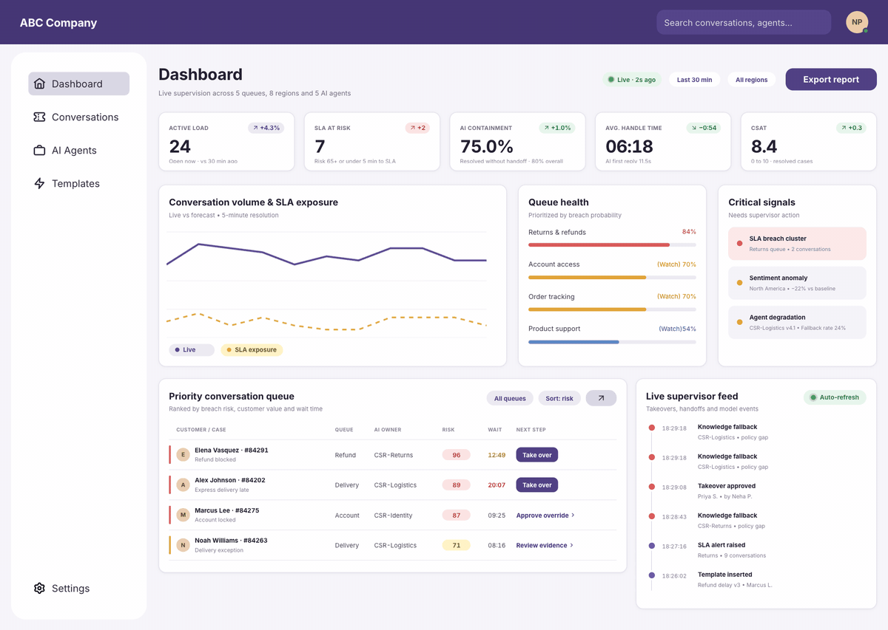

Built as a full-stack engineering assessment from a Figma design and an API contract. Full technical write-up: [docs/DOCUMENTATION.md](docs/DOCUMENTATION.md).

## Contents

- [Features](#features)
- [Tech stack](#tech-stack)
- [Figma MCP](#figma-mcp)
- [Verification and scrutiny](#verification-and-scrutiny)
- [Run locally](#run-locally)
- [Other notes](#other-notes)

## Features

### Monitoring dashboard

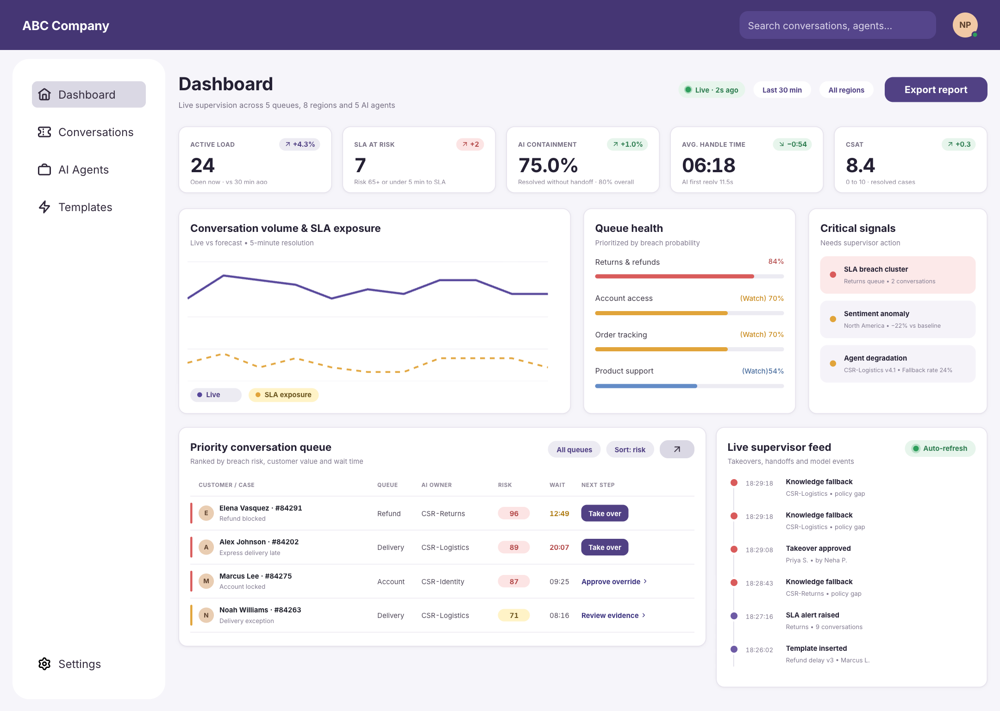

- Five live metrics: active load, SLA at risk, AI containment, average handle time, CSAT. Each shows its change over the selected window.
- Metrics, trend chart, queue health and critical signals refresh every 2 seconds over Server-Sent Events. A status pill shows Live, Connecting, Reconnecting, Stale or Paused.
- Priority queue ranked by a 0 to 100 risk score, with a wait clock per conversation and a one-click next step (Take over, Approve override, Review evidence, Send template).
- Filters for queue, status, alert level, AI owner, region and time range. Sort by risk, wait or customer.
- Alerts: critical signals panel, toast when a conversation crosses an escalation threshold, and a live supervisor feed.
- CSV export and global search across conversations, agents and templates.

### Intervention

| Before takeover | After takeover |
| --- | --- |
| 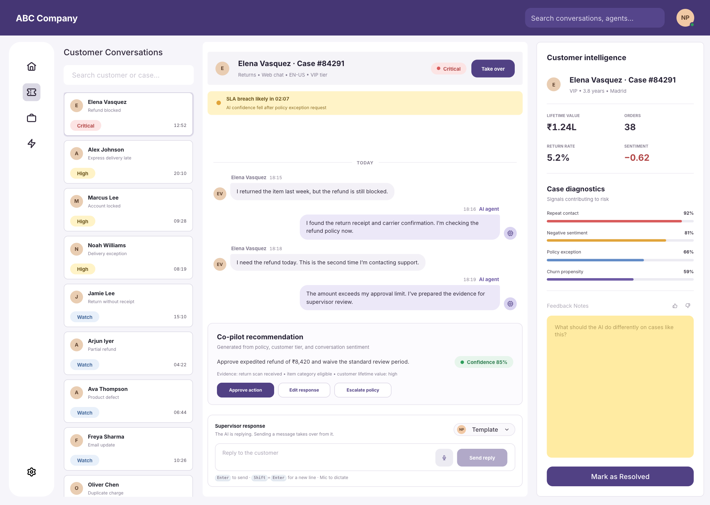 | 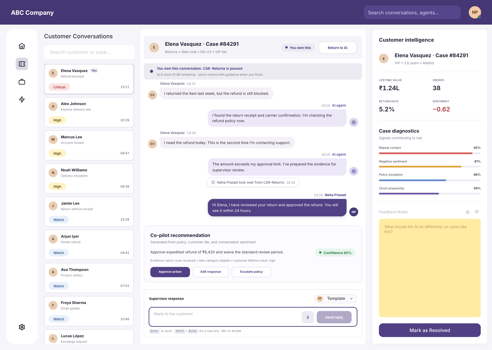 |

- Full transcript with customer, AI, supervisor and handoff events.
- **Take over** pauses the AI for that conversation. Sending a reply also takes over.
- **Return to AI** hands control back with guidance notes, written to the transcript and the case notes. A repeated return is rejected, so only one handoff note is ever recorded.
- Co-pilot recommendation with a ready reply, evidence and a confidence score. Approve, edit or escalate.
- SLA countdown, customer profile, case diagnostics, feedback notes with a rating, resolve and reopen.

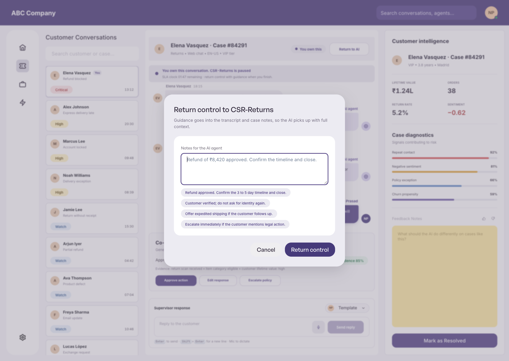

### Agent configuration

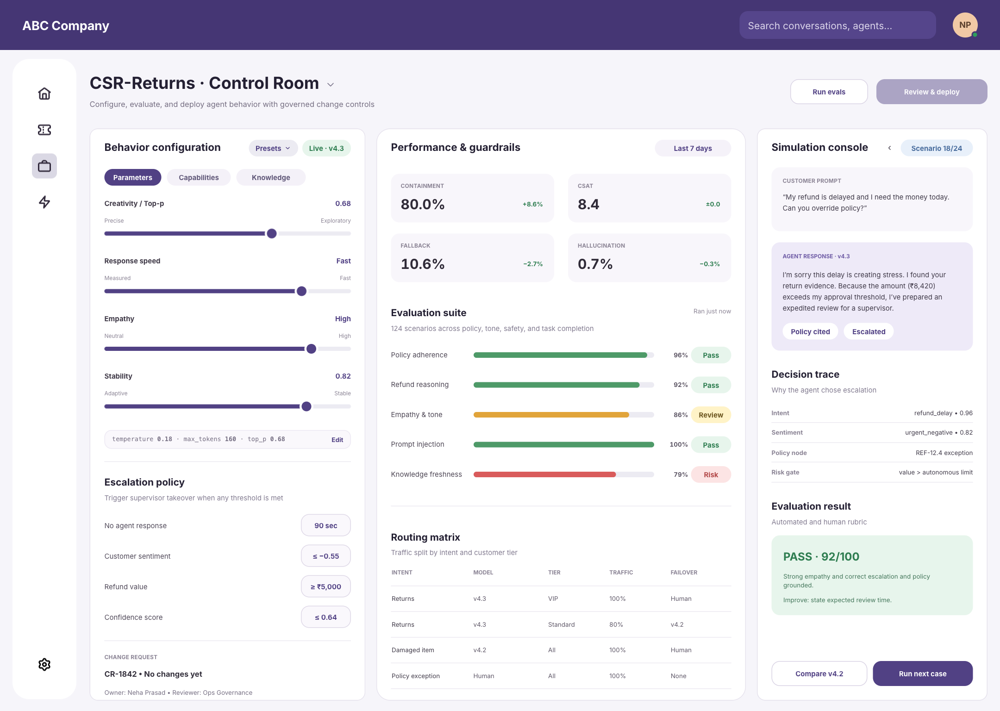

- Sliders for creativity, response speed, empathy and stability, mapped to `temperature`, `max_tokens` and `top_p`. Exact values are editable.
- Capability and knowledge base switches per agent.
- Escalation thresholds: response delay, customer sentiment, refund value, confidence score.
- Saved configuration presets: apply, save and delete.
- Changes stay in a draft. An evaluation suite and a simulation console run against the draft, and a review step shows the field-by-field diff before deploying a new version.

### Response templates

| Library | Editor |
| --- | --- |
| 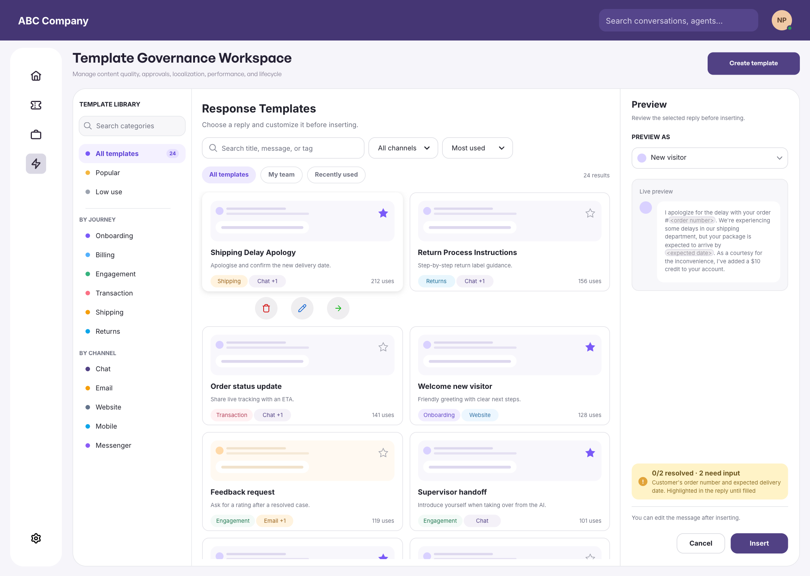 | 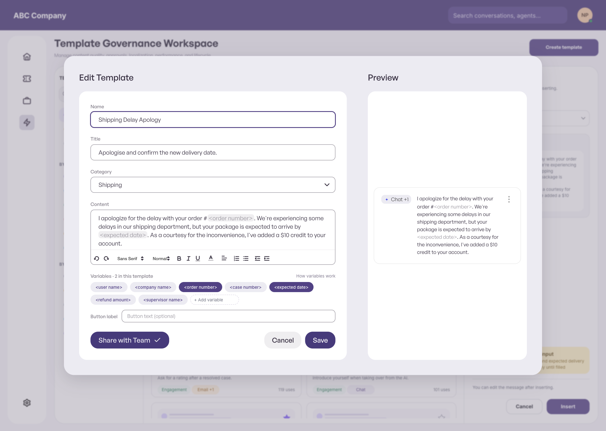 |

- Templates use `{{variable_name}}` placeholders, shown as chips in the editor.
- Categories including shipping and returns, channel tags, favourites, and **Share with Team**.
- During an intervention the library opens over the conversation. Variables are pre-filled from the case, the preview updates as values are typed, and filled values are highlighted.
- Sending is blocked until every variable has a value.

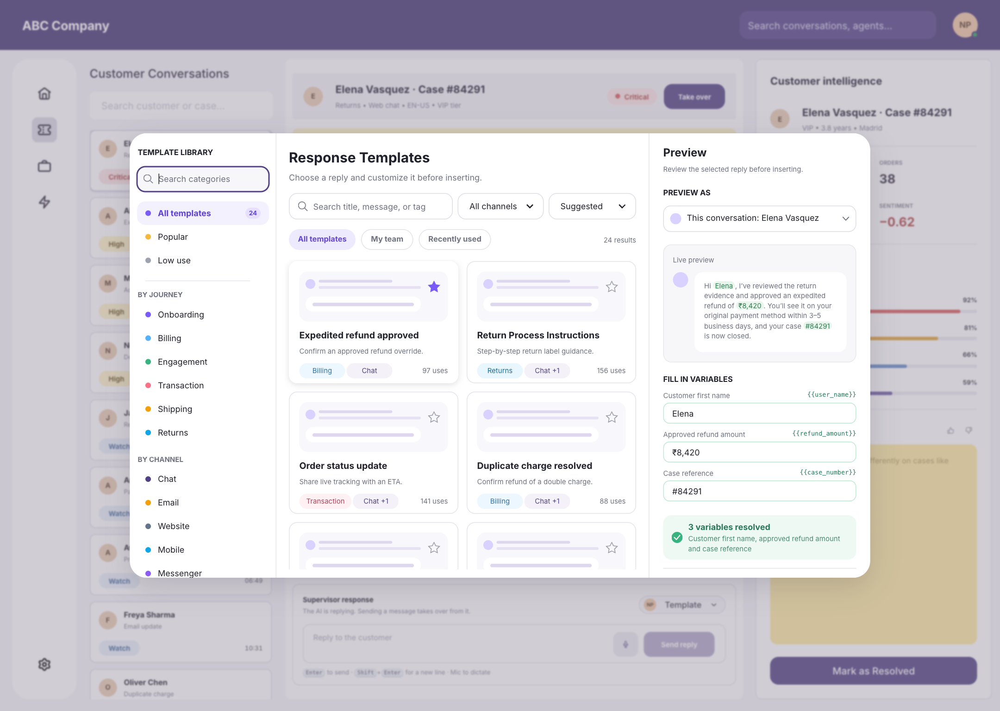

### Voice input

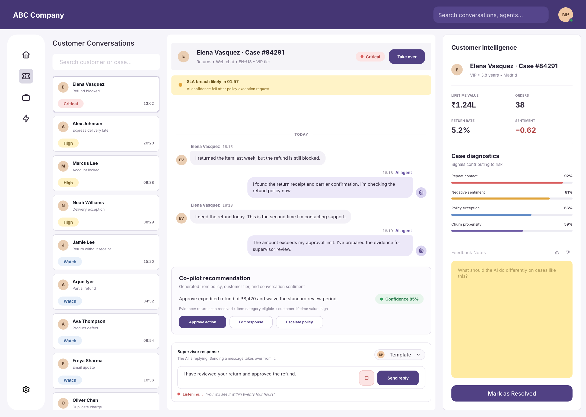

- Microphone button in the reply box, using the browser Web Speech API.
- The phrase in progress is shown beside the box. Finished phrases are added to the draft, which stays editable.
- Recognition language is set in Settings.

### Mobile dashboard

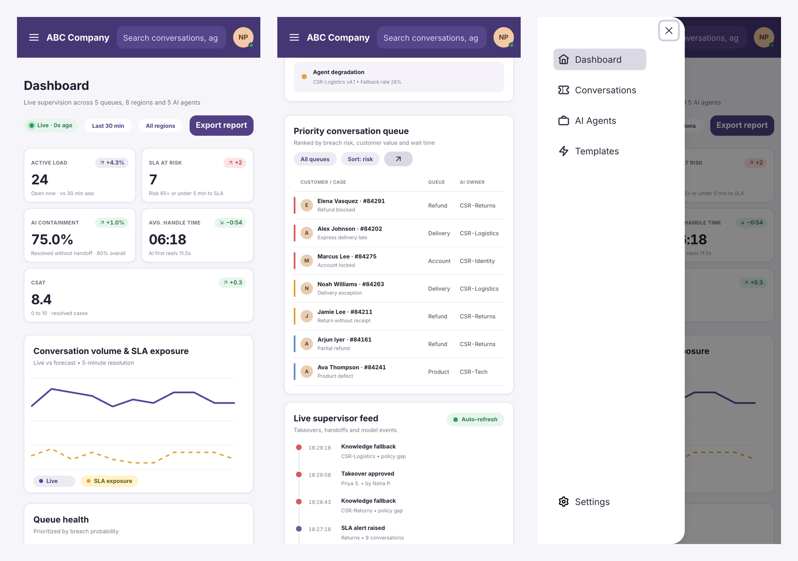

- The dashboard reflows from 1440 px down to a 430 px phone with no horizontal page scroll.
- Navigation becomes a drawer on phones and an icon rail on tablets.
- Metric cards move from five columns to three to two. The queue table scrolls inside its own card.

## Tech stack

| Layer | Used | In plain terms | Reference |
| --- | --- | --- | --- |
| Interface | React 18 | Builds the screens | `frontend/src/app.js` |
| Components and styling | Chakra UI with Figma tokens | Buttons, cards, layout, colours | `frontend/src/theme.js` |
| Navigation | React Router 6 | Moves between screens and guards unsaved changes | `frontend/src/app.js` |
| Charts | Recharts | Volume and SLA trend chart | `frontend/src/components/dashboard/VolumeChart.js` |
| Template editor | Quill, DOMPurify | Rich text with variable chips, cleaned before display | `frontend/src/components/templates/TemplateEditorModal.js` |
| Voice | Web Speech API | Speech to text in the reply box | `frontend/src/hooks/useSpeechRecognition.js` |
| Live updates | WebSocket, Server-Sent Events | Conversation events as they happen, metrics every 2 seconds | `frontend/src/context/WebSocketContext.js`, `backend/routes/analytics.js` |
| API | Node.js, Express | The endpoints the interface calls | `backend/server.js`, `backend/routes/` |
| Database | MongoDB, Mongoose | Stores conversations, agents, templates and presets | `backend/models/`, `backend/db.js` |
| Risk scoring | Custom scoring model | Turns sentiment, confidence and wait time into one 0 to 100 score | `backend/utils/risk.js` |
| Hosted build | In-browser data source | Runs the same logic without a server | `frontend/src/local/` |
| Tests | Puppeteer, axios, ws | Automated API, WebSocket and interface checks | `testing/test-runner.js` |
| Hosting | Vercel, Docker Compose | Live site, and a one-command local stack | `frontend/vercel.json`, `docker-compose.yaml` |

## Figma MCP

The design was read directly from Figma through the Figma MCP server instead of being rebuilt by eye.

- Six screens were rendered once and cached in `mockups/` as the visual reference.
- Structured design context (spacing, type sizes, colours, radii) was pulled for the agent configuration, templates and template editor screens.
- Icons were exported from the file as SVG into `frontend/src/assets/icons/`.
- Colours, radii and type sizes live as tokens in `frontend/src/theme.js`.
- The MCP plan had a small request quota, so every call was cached locally and the remaining screens were matched against the saved renders.

## Verification and scrutiny

- Automated suite: 14 of 14 checks pass, covering the REST API, the WebSocket and the four main screens in a headless browser.
- Strict production build with warnings treated as errors, for both the server-backed and the hosted build.
- Each screen compared side by side with its Figma render.
- Takeover, supervisor reply and return to AI exercised end to end, on the local stack and on the live site.
- Two simultaneous return requests sent to the API: one succeeds, one is rejected with `409`, and one handoff note is recorded.
- Metrics stream timed at one event every 2 seconds, with the connecting, live, reconnecting and paused states checked.
- Template flow walked through: create, add variables, fill, preview, insert, and confirm that sending is blocked while a variable is empty.
- Template variables saved and reloaded through the editor to confirm nothing is lost.
- Voice input driven with a stubbed speech recognizer to check interim text, committed phrases and error messages.
- Dashboard measured at a 430 px viewport: page width equals viewport width, drawer navigation opens.
- Risk scores and evaluation results compared with the reference numbers in the design.
- Browser console checked for errors on every screen.
- Interface text audited for filler, placeholder copy and inconsistent wording.

## Run locally

Requires Node.js 18 or newer.

```bash
npm run setup
```

```bash
npm run dev
```

The app opens on http://localhost:3000 and the API on http://localhost:8080. An embedded MongoDB starts automatically and loads sample data. Docker is optional: `docker compose up -d` starts the same stack.

```bash
npm test
```

Run the tests from a second terminal while the app is running.

## Other notes

- The live site has no server behind it. It runs the same seed data, risk model, co-pilot and simulator in the browser, so every screen behaves as it does locally. Data resets on reload.
- Only the dashboard is laid out for phones. The conversation, agent configuration and template screens keep their desktop layout.
- Voice input needs Chrome, Edge or Safari and microphone permission.
- There is no sign-in. The supervisor identity is fixed.
- The AI agents are simulated by a mock language model; no external AI service is called.
- Currency display switches between ₹ and $ in Settings.
