# Supervisor Workstation Architecture

How the supervisor console is built: what each screen shows, what runs behind every control, which addresses the browser calls, and where the data lives.

A designed version of this document, with the same content, is in [architecture.html](architecture.html).

## Contents

1. [The system in one picture](#1-the-system-in-one-picture)
2. [Three kinds of connection](#2-three-kinds-of-connection)
3. [Screen by screen](#3-screen-by-screen)
4. [What happens when](#4-what-happens-when)
5. [Route map](#5-route-map)
6. [What is stored](#6-what-is-stored)
7. [Always running in the background](#7-always-running-in-the-background)
8. [How risk is scored](#8-how-risk-is-scored)
9. [How the frontend is put together](#9-how-the-frontend-is-put-together)
10. [The hosted version](#10-the-hosted-version)
11. [Folder map](#11-folder-map)

## 1. The system in one picture

Three parts: the supervisor's browser, one server, one database. The browser never touches the database. Everything goes through the server.

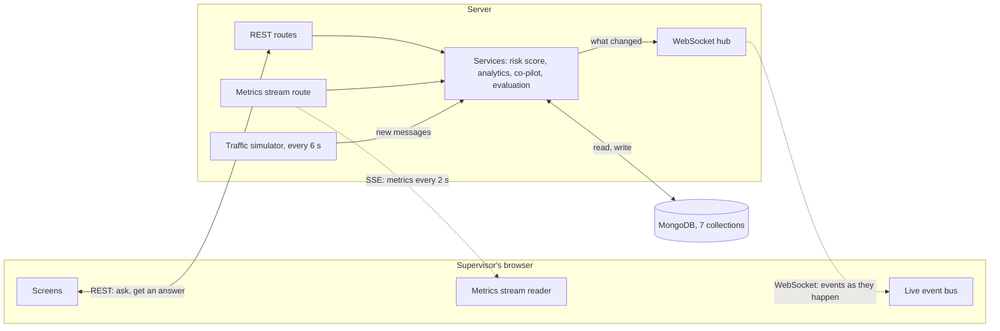

The services are the only part that reads or writes the database, and they tell the hub about every change.

## 2. Three kinds of connection

| Connection | In plain terms | Direction | Used for |
| --- | --- | --- | --- |
| REST | The browser asks a question or sends an action. The server answers once and the exchange ends. | Browser asks, server answers | Loading screens, take over, send a reply, save a template, deploy a change |
| WebSocket | One connection stays open. The server can speak at any moment without being asked. | Server to browser, at any time | New messages, risk changes, alerts, the activity feed |
| SSE | One connection stays open and the server sends on a fixed beat. The browser reconnects by itself if it drops. | Server to browser, every 2 seconds | The dashboard's numbers, chart, queue health and signals |

## 3. Screen by screen

Each number on a screenshot matches a row in the table under it.

### Dashboard `/`

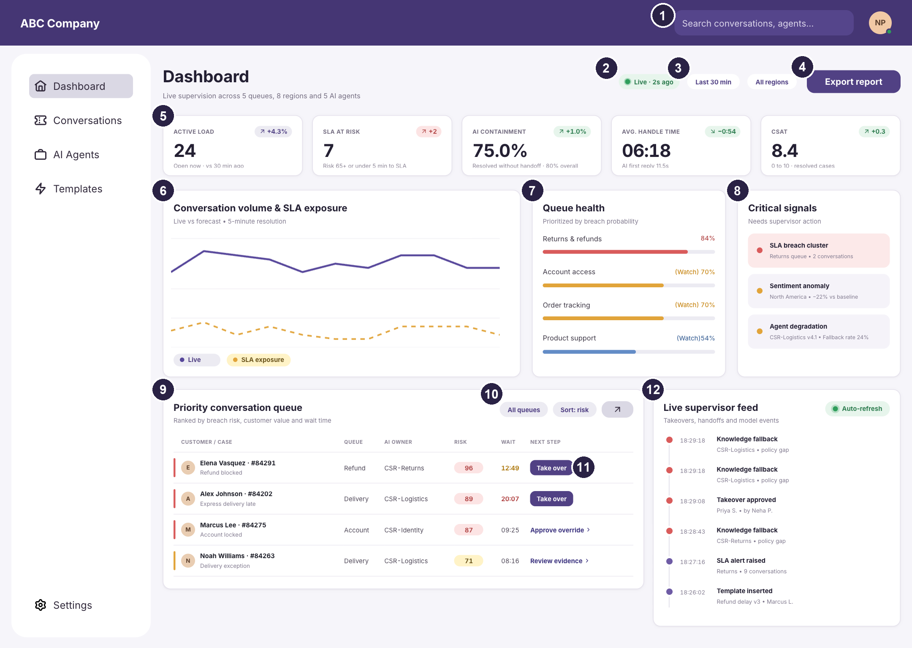

| # | On screen | Behind the scenes | Route or event | Type |
| --- | --- | --- | --- | --- |
| 1 | Search box | Waits for a pause in typing, then looks across conversations, agents and templates. | `GET /api/search` | REST |
| 2 | Live status | Shows the age of the last metrics update. Changes to Reconnecting or Paused when the stream is not flowing. | `GET /api/analytics/stream` | SSE |
| 3 | Time range and region | Changing either one reloads the dashboard and restarts the stream for the new selection. | `GET /api/analytics/dashboard` | REST |
| 4 | Export report | Builds a CSV file in the browser from the numbers already on screen. No server call. | None | Browser |
| 5 | Metric cards | The server counts open conversations, scores each one and totals the results. New values arrive every 2 seconds. | `metrics` event | SSE |
| 6 | Volume and SLA chart | Drawn from metric snapshots the server saves about once a minute. | `metrics` event | SSE |
| 7 | Queue health | Risk scores grouped by queue. Clicking a row filters the priority queue. | `metrics` event | SSE |
| 8 | Critical signals | Three checks: several risky chats in one queue, one region's mood dropping, an agent falling back too often. | `metrics` event | SSE |
| 9 | Priority queue | Every open conversation, highest risk first. Rows update the moment a message arrives. Wait clocks tick in the browser. | `conversation_updated`, `new_conversation` | WebSocket |
| 10 | Filters and sort | Applied in the browser to the list it already holds, so they respond instantly. | None | Browser |
| 11 | Take over | Pauses the AI on that conversation, then opens it. | `POST /api/intervene` | REST |
| 12 | Supervisor feed | A running log of takeovers, handoffs, alerts and deployments. | `GET /api/activity`, then `activity` events | WebSocket |

### Conversation `/conversation/:id`

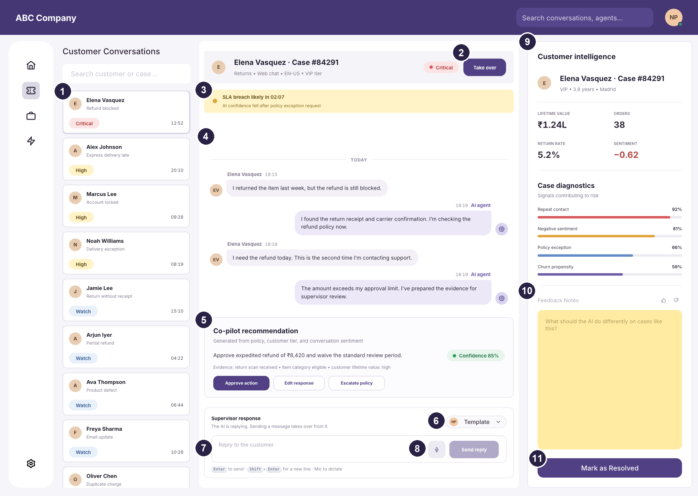

| # | On screen | Behind the scenes | Route or event | Type |
| --- | --- | --- | --- | --- |
| 1 | Conversation list | The same live list the dashboard uses, kept current by events. | `conversation_updated` | WebSocket |
| 2 | Take over | Marks the conversation as owned by a human. The simulator stops writing AI replies for it. After takeover this button becomes Return to AI. | `POST /api/intervene` | REST |
| 3 | SLA banner | The countdown to the 15 minute target and the main reason for the risk, both from the risk model. | `GET /api/conversations/:id` | REST |
| 4 | Transcript | Loaded once, then each new message is appended as it arrives. | `message_update` | WebSocket |
| 5 | Co-pilot recommendation | The server picks a playbook for the queue, looks up the policy and writes a ready reply with a confidence figure. Approve sends it. | `GET /api/conversations/:id/copilot` | REST |
| 6 | Template | Opens the template library over the conversation, with the blanks filled from this case. | `GET /api/templates` | REST |
| 7 | Reply box | Sends the supervisor's message. Send stays off while any template blank is empty. | `POST /api/conversations/:id/messages` | REST |
| 8 | Microphone | Speech is turned into text by the browser. Finished phrases are added to the draft. | None | Browser |
| 9 | Customer details and diagnostics | Profile fields and four percentages produced by the risk model. | `GET /api/conversations/:id` | REST |
| 10 | Feedback notes | Saved automatically a moment after typing stops. | `PUT /api/conversations/:id/feedback` | REST |
| 11 | Mark as Resolved | Closes the case and ends any takeover. | `PATCH /api/conversations/:id/status` | REST |

### Agent configuration `/agent-config`

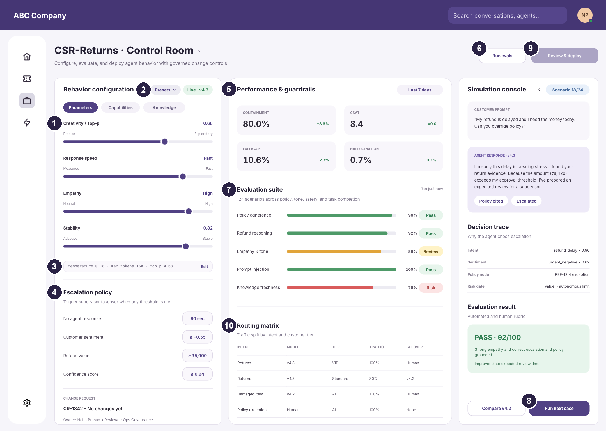

| # | On screen | Behind the scenes | Route or event | Type |
| --- | --- | --- | --- | --- |
| 1 | Behaviour sliders | Changes are held as a draft in the browser. The live agent is untouched until deploy. | None | Browser |
| 2 | Presets | Loads a saved configuration into the draft, or saves the draft under a name. | `GET` and `POST /api/presets` | REST |
| 3 | Exact values | The real settings behind the sliders: temperature, max tokens, top-p. | None | Browser |
| 4 | Escalation policy | The limits that force a handover to a human. The risk model and the simulator both read them. | Saved on deploy | Browser |
| 5 | Performance | Worked out from resolved conversations for this agent over the chosen period. | `GET /api/agents/:id/performance` | REST |
| 6 | Run evals | Sends the draft to be scored on five checks before anything goes live. | `POST /api/agents/:id/evaluate` | REST |
| 7 | Evaluation suite | The five scores, each marked Pass, Review or Risk. | `GET /api/agents/:id/evaluation` | REST |
| 8 | Simulation console | Replays a sample customer message against the draft and shows how the agent would answer. | `POST /api/agents/:id/simulate` | REST |
| 9 | Review and deploy | Shows a field-by-field comparison, then saves. The version goes up by one and the old settings are kept. | `PATCH /api/agents/:id/config` | REST |
| 10 | Routing matrix | Updates to the new version after a deploy, on every open screen. | `agent_update` | WebSocket |

### Templates `/templates`

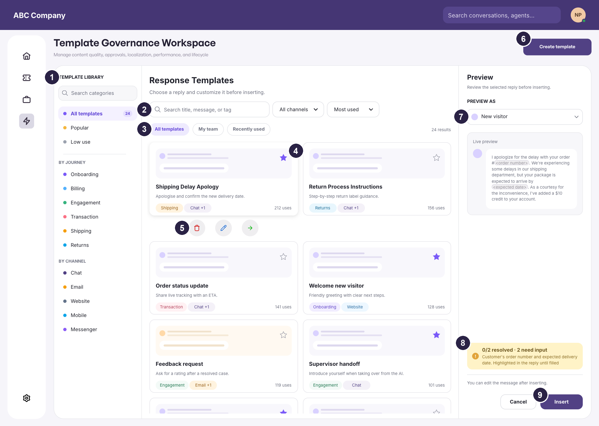

| # | On screen | Behind the scenes | Route or event | Type |
| --- | --- | --- | --- | --- |
| 1 | Library navigation | Groups by journey and channel. Filtering happens in the browser on the loaded list. | `GET /api/templates` | REST |
| 2 | Search, channel, sort | Applied in the browser. | None | Browser |
| 3 | All, My team, Recently used | My team shows templates marked as shared. | None | Browser |
| 4 | Favourite star | Changes at once on screen, then saves. If the save fails it switches back. | `PATCH /api/templates/:id` | REST |
| 5 | Delete, edit, use | Edit opens the editor. Use opens a conversation with this template ready. | `DELETE /api/templates/:id` | REST |
| 6 | Create template | The server removes unsafe HTML, finds every `{{blank}}` and stores the list. | `POST /api/templates` | REST |
| 7 | Preview | Fills the blanks for a chosen customer and shows the result. Empty blanks are marked. | None | Browser |
| 8 | Resolved count | How many blanks have a value and which still need one. | None | Browser |
| 9 | Insert | Places the filled text in the reply box of a conversation. | None | Browser |

### On a phone

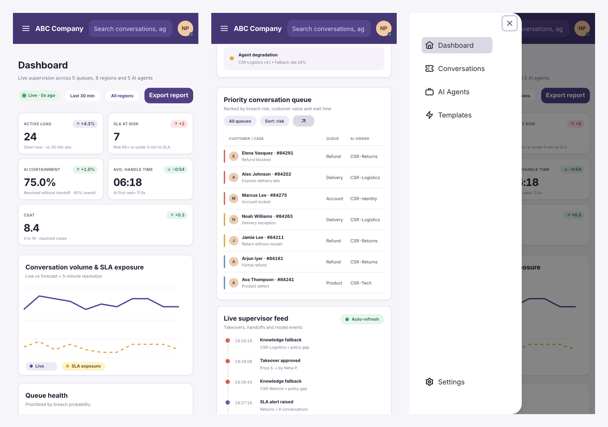

The same dashboard code, with layout values that change by screen width. Cards go from five columns to three to two, the sidebar becomes a drawer, and the queue scrolls inside its own card so the page never scrolls sideways.

## 4. What happens when

Solid arrows are requests the browser makes. Dashed arrows are things the server sends.

### The dashboard opens and stays live

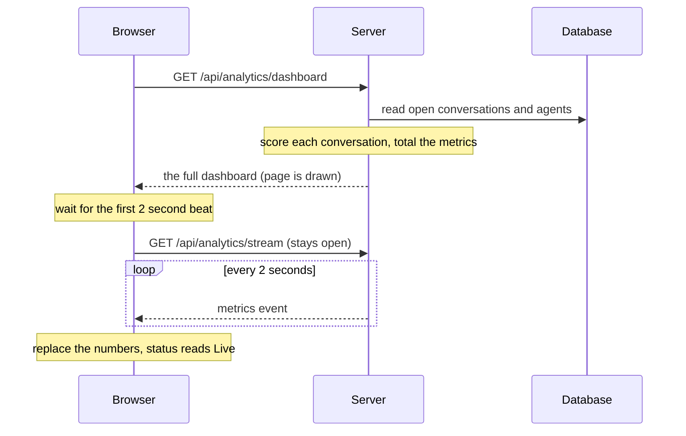

**Why the stream waits 2 seconds.** The automated test for this screen waits until the browser has no requests in progress. A stream is a request that never finishes, so opening it straight away meant the page never looked finished and the test failed. The page now loads with a normal request first and opens the stream at the first 2 second beat.

### A customer message arrives

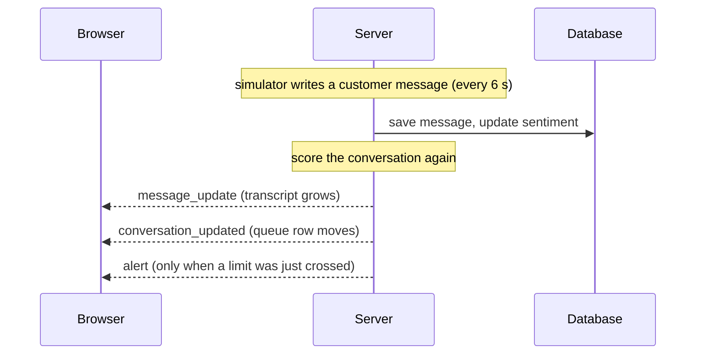

### Take over, reply, return to AI

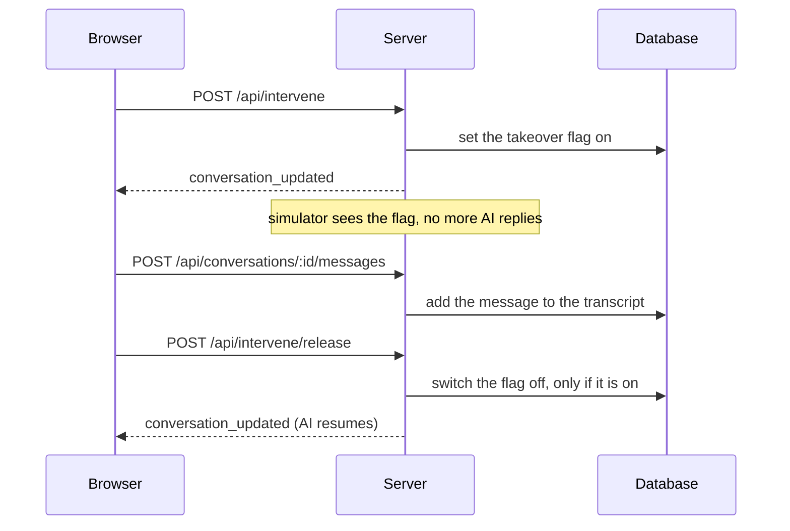

### The duplicate handoff note, before and after

If Return to AI was triggered twice at nearly the same moment, two handoff notes were written. Both requests checked the flag before either had changed it.

Before: check, then write, as two separate steps.

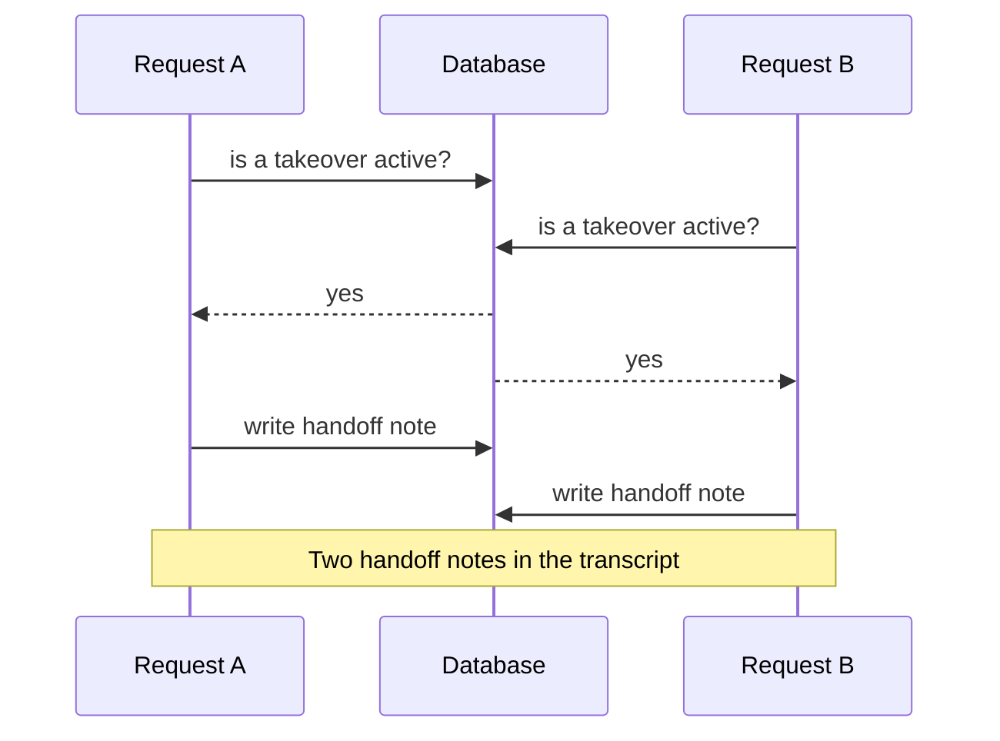

After: check and switch off in one database step.

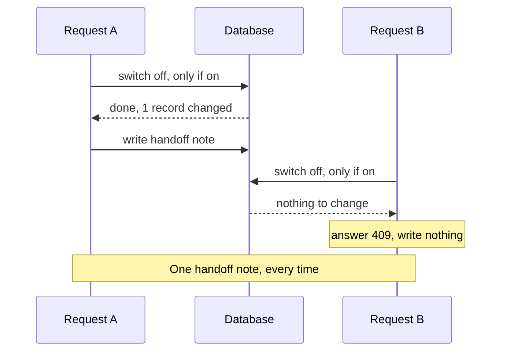

### A template is used in a reply

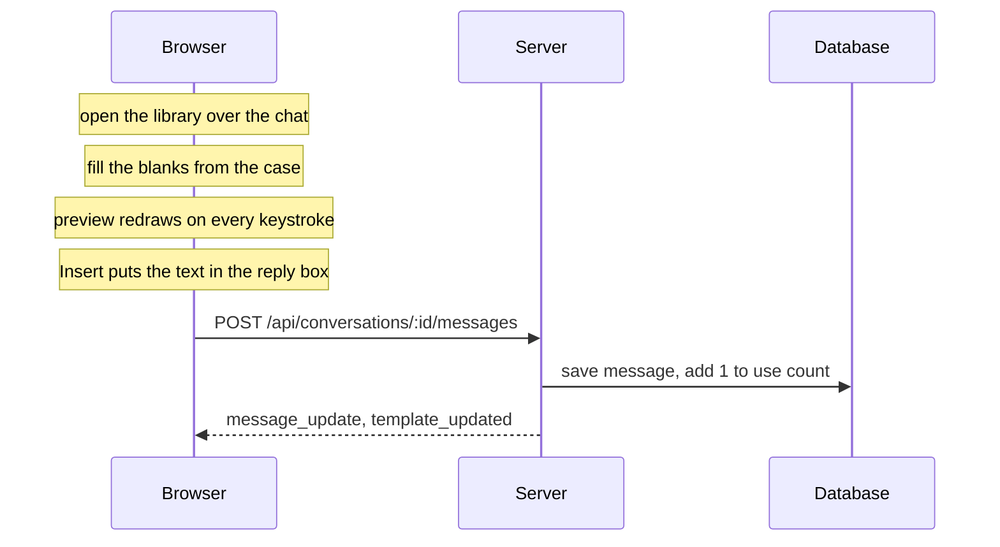

Send stays off while any blank is empty.

### A configuration change is deployed

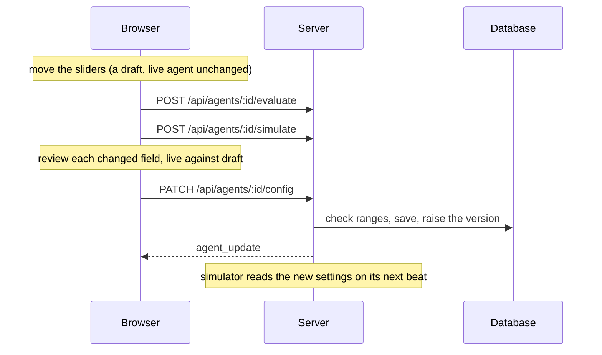

## 5. Route map

### Screen routes

| Address | Screen | Loaded |
| --- | --- | --- |
| `/` | Dashboard | With the app |
| `/conversations`, `/conversation/:id` | Conversation | On first visit |
| `/agent-config` | Agent configuration | On first visit |
| `/templates` | Templates | On first visit |
| `/settings` | Settings | On first visit |

### Conversations and intervention

| Route | What it does |
| --- | --- |
| `GET /api/conversations` | Lists conversations. Accepts filters, a search term and sort by risk. |
| `GET /api/conversations/:id` | One conversation with its transcript and current risk. |
| `POST /api/conversations/:id/messages` | Adds a message. Used for supervisor replies. |
| `PATCH /api/conversations/:id/status` | Resolves, reopens or escalates. |
| `POST /api/conversations/:id/tags` | Adds tags. |
| `PUT /api/conversations/:id/feedback` | Saves feedback notes and the rating. |
| `GET /api/conversations/:id/copilot` | Returns the recommended action and a ready reply. |
| `POST /api/conversations/:id/copilot/decision` | Records that the supervisor approved or escalated. |
| `POST /api/intervene` | Take over from the AI. |
| `POST /api/intervene/release` | Return to the AI with notes. A second call is refused with 409. |

### Agents and presets

| Route | What it does |
| --- | --- |
| `GET /api/agents`, `GET /api/agents/:id` | Agents with their settings, capabilities and thresholds. |
| `PATCH /api/agents/:id/config` | Checks every value is in range, saves, and raises the version when deployed. |
| `GET /api/agents/:id/metrics` | Stored performance figures. |
| `GET /api/agents/:id/performance` | Containment, satisfaction, fallback and hallucination for a period. |
| `GET /api/agents/:id/evaluation` | The latest evaluation result. |
| `POST /api/agents/:id/evaluate` | Scores the live settings or a draft. |
| `POST /api/agents/:id/simulate` | Replays a sample case, optionally against the previous version too. |
| `GET /api/presets`, `POST /api/presets` | Lists and saves named configurations. |
| `DELETE /api/presets/:id`, `POST /api/presets/:id/apply` | Removes a preset, or applies one straight to an agent. |

### Templates

| Route | What it does |
| --- | --- |
| `GET /api/templates` | Lists templates. Accepts search, category, channel and sort. |
| `POST /api/templates` | Creates one. Cleans the HTML and records its blanks. |
| `GET`, `PATCH`, `DELETE /api/templates/:id` | Reads, edits or removes one. |
| `POST /api/templates/:id/render` | Fills the blanks on the server and returns the finished text. |

### Analytics and system

| Route | What it does |
| --- | --- |
| `GET /api/analytics/dashboard` | Everything the dashboard shows, in one answer. |
| `GET /api/analytics/stream` | The same numbers as a stream, every 2 seconds. |
| `GET /api/analytics/overview`, `/agents`, `/issues` | Totals and trends by day, by agent and by issue. |
| `GET /api/activity` | Recent entries for the supervisor feed. |
| `GET /api/search` | Search across conversations, agents and templates. |
| `GET /api/system/status`, `POST /api/system/simulation` | Reads and switches the traffic simulator. |
| `POST /api/system/reset` | Reloads the sample data. |
| `GET /api/knowledge-base`, `POST /api/vector/search` | Knowledge sources and policy lookup. |
| `GET /health`, `GET /api-docs` | Health check and the interactive API reference. |

### Live events over WebSocket

| Event | Sent when | Effect on screen |
| --- | --- | --- |
| `conversations_update` | A browser connects | Fills the live list |
| `new_conversation` | A customer starts a chat | A new row appears in the queue |
| `message_update` | Any message is added | The transcript grows |
| `conversation_updated` | Status, risk or ownership changes | The row moves and its labels change |
| `metrics_update` | Sentiment or confidence changes | Figures on the conversation screen update |
| `alert` | A conversation crosses an escalation limit | A toast with a link to the conversation |
| `activity` | A takeover, handoff, alert or deploy | A new line in the supervisor feed |
| `agent_update` | An agent's settings are saved | Version and routing update |
| `template_created`, `_updated`, `_deleted` | A template changes | The library updates on every open screen |
| `preset_created`, `_deleted` | A preset changes | The presets menu updates |

## 6. What is stored

Seven collections in MongoDB. The risk score is not stored: it depends on how long the customer has waited, so it is worked out each time it is needed.

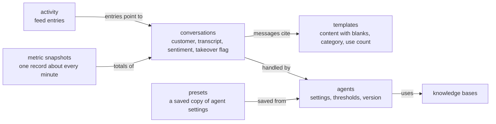

Messages are kept inside their conversation record, so opening a conversation is a single read.

## 7. Always running in the background

| Job | How often | What it does |
| --- | --- | --- |
| **Traffic simulator** | Every 6 seconds | Picks one open conversation and moves it forward: a customer message or an AI reply written with that agent's current settings. Skips AI replies on conversations a supervisor owns. |
| **New conversation** | About every 42 seconds | Opens a new chat while fewer than 30 are open. |
| **Resolve one** | About every 48 seconds | Closes a calm, low-risk conversation, as an AI agent would. |
| **Metric snapshot** | About once a minute | Saves the current totals so the trend chart has history. |
| **Metrics stream** | Every 2 seconds, per open dashboard | Recomputes the dashboard and sends it. Stops when that browser disconnects. |
| **Connection check** | Every 30 seconds | Pings each browser and drops any that stopped answering. |

There is one simulator for the whole server. An earlier design started one per connected browser, so every extra open tab multiplied the traffic.

## 8. How risk is scored

One function scores every conversation from 0 to 100. The dashboard, the conversation screen and the simulator all use it, so they cannot disagree.

| Signal | Weight |
| --- | --- |
| Customer sentiment | 36 |
| AI confidence | 24 |
| Time against the SLA | 16 |
| Asked for a human | 12 |
| Policy exception | 10 |
| VIP customer | 6 |
| Each repeat contact | 6 |

The parts are added up and passed through an S-shaped curve that turns any total into a figure between 0 and 100.

| Score | Label on screen | What follows |
| --- | --- | --- |
| 90 to 100 | Critical | Take over is recommended |
| 70 to 89 | High | Alert level becomes high at 80 |
| 50 to 69 | Watch | Alert level becomes medium at 60. Counts as SLA at risk from 65 |
| 0 to 49 | Stable | The AI continues alone |

An agent's escalation thresholds can raise the alert on their own. Two limits crossed, or a customer asking for a human, makes the alert high whatever the score.

## 9. How the frontend is put together

Each layer makes something available to everything inside it.

| Layer | What it provides |
| --- | --- |
| Theme | Colours, spacing and type sizes taken from the Figma design |
| Settings | Currency, names and preferences, remembered in the browser |
| Live connection | The one WebSocket. Reconnects by itself and passes each event to whichever parts asked for it |
| Router | Decides which screen to show for the address in the browser |
| Shared live data | Open conversations and agents, plus the actions every screen uses |
| Frame | Top bar with search, and the sidebar or mobile drawer |
| Screen | Dashboard, Conversation, Agent configuration, Templates or Settings |

| Screen | Building blocks |
| --- | --- |
| Dashboard | Metric card, volume chart, queue health, critical signals, priority queue, supervisor feed |
| Conversation | Conversation list, message list, co-pilot card, reply composer, customer details, return to AI dialog, template picker |
| Agent configuration | Behaviour panel, presets menu, performance panel, simulation console, review and deploy dialogs |
| Templates | Template workspace, template card, template editor |

## 10. The hosted version

The live site is served as plain files with no server behind it. The screens are identical. What answers them is different.

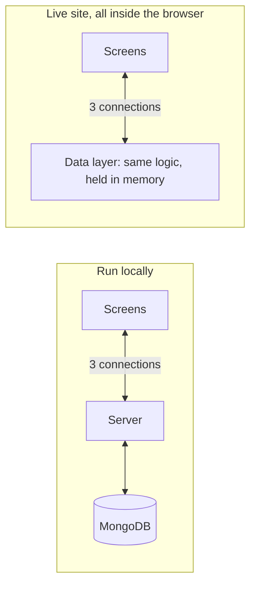

The data layer answers the same REST addresses, sends the same WebSocket events and the same metrics stream. It reuses the server's risk model, co-pilot, simulator and sample data. Data resets when the page is reloaded.

## 11. Folder map

```
backend/
  server.js            starts everything: routes, database, simulator
  routes/              one file per group of addresses in section 5
  services/            analytics, co-pilot, evaluation, simulator
  utils/risk.js        the risk score in section 8
  websocket/           the hub and the per-browser connection handler
  models/              the seven collections in section 6
frontend/src/
  pages/               the five screens
  components/          the building blocks listed in section 9
  context/             live connection, shared live data, settings
  hooks/               voice input, templates, the one-second clock
  theme.js             design tokens from Figma
  local/               the data layer for the hosted version
testing/               the 14 automated checks
docs/                  this document, screenshots, full documentation
```
