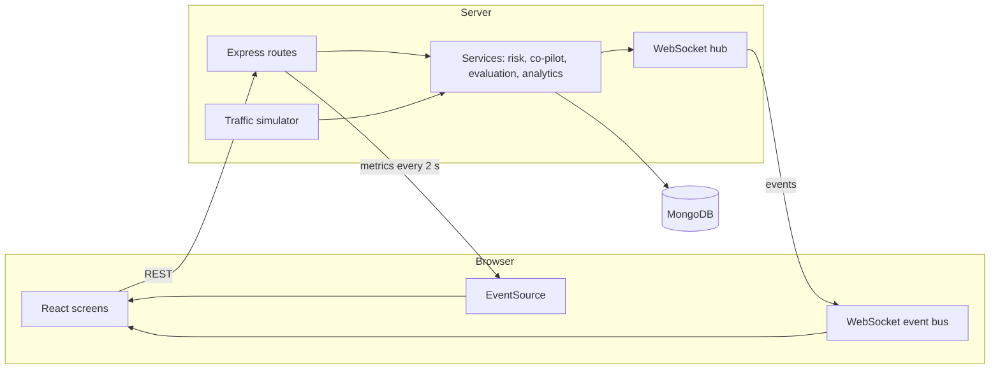

# AI Agent Supervisor Workstation: Documentation

Technical reference for the project. The [README](../README.md) covers the features with screenshots; this document covers how it is built and how it was checked.

Live site: https://ai-agent-supervisor-workstation.vercel.app

## Contents

1. [Scope](#1-scope)
2. [Requirement coverage](#2-requirement-coverage)
3. [Requirements added during the build](#3-requirements-added-during-the-build)
4. [System overview](#4-system-overview)
5. [Frontend](#5-frontend)
6. [Backend](#6-backend)
7. [Risk model](#7-risk-model)
8. [Real-time design](#8-real-time-design)
9. [Response templates](#9-response-templates)
10. [Agent configuration flow](#10-agent-configuration-flow)
11. [Sample data](#11-sample-data)
12. [API summary](#12-api-summary)
13. [Hosted build](#13-hosted-build)
14. [Design process and Figma MCP](#14-design-process-and-figma-mcp)
15. [Verification](#15-verification)
16. [Problems and resolutions](#16-problems-and-resolutions)
17. [Limitations](#17-limitations)
18. [Repository layout](#18-repository-layout)
19. [Configuration](#19-configuration)

## 1. Scope

The project was built as a full-stack engineering assessment with a fixed time limit.

**Provided at the start**

- A Figma file with six screens.
- A partial Express and React codebase with known defects.
- An API contract and a WebSocket event list.
- An automated test runner.

**Asked for**

- A monitoring dashboard for live AI conversations.
- An intervention interface for taking over and handing back.
- An agent configuration screen.
- A response template feature, announced as an additional requirement.
- Further requirements issued partway through the build (section 3).

## 2. Requirement coverage

### Monitoring dashboard

| Requirement | Implementation |
| --- | --- |
| Real-time view of conversations | Priority queue updated over WebSocket, wait clocks ticking every second |
| Key metrics | Active load, SLA at risk, AI containment, average handle time, CSAT, with response time and resolution rate in the card details |
| Alerts | Risk score and alert level per conversation, critical signals panel, threshold toasts, supervisor feed |
| Filtering | Queue, status, alert level, AI owner, region, time range, and sort by risk, wait or customer |

### Intervention

| Requirement | Implementation |
| --- | --- |
| Conversation history | Grouped transcript with customer, AI, supervisor and system events |
| Take over | Take over button, or sending a reply. The simulator stops AI replies for that conversation |
| Return control with notes | Return to AI dialog with suggested guidance. Notes are stored in the transcript and in `supervisorNotes` |
| Supervisor messages | Reply composer with template insert and voice input |
| Feedback on the agent | Autosaved feedback notes and a rating |

### Agent configuration

| Requirement | Implementation |
| --- | --- |
| Adjust parameters | Sliders mapped to `temperature`, `max_tokens`, `top_p` and empathy, plus direct numeric entry |
| Enable or disable capabilities | Per-agent switches for capabilities and knowledge bases |
| Escalation thresholds | Response delay, sentiment, refund value, confidence. Enforced by the simulator |
| Presets | Apply, save and delete named presets |

### Response templates

| Requirement | Implementation |
| --- | --- |
| Management screen | Library with journey and channel navigation, search, sort, favourites, edit and delete |
| Creation | Rich text editor with variable chips, category, channels and team sharing |
| Use during intervention | Picker over the conversation with pre-filled variables and a live preview |
| Variable substitution clearly indicated | Resolved values highlighted, unresolved variables shown as chips, sending blocked until all are filled |

## 3. Requirements added during the build

| Requirement | Implementation | Files |
| --- | --- | --- |
| `{{variable_name}}` syntax, shipping and returns categories, share with team | Variables detected in content and listed with descriptions. `isShared` drives the My team tab | `frontend/src/components/templates/`, `backend/routes/templates.js` |
| Fill variables and preview before sending | Fill-in fields pre-populated from the case, preview re-rendered on every keystroke | `TemplateWorkspace.js`, `ReplyComposer.js` |
| Dashboard metrics every 2 seconds over SSE | `GET /api/analytics/stream` pushes a `metrics` event every 2 seconds | `backend/routes/analytics.js`, `frontend/src/pages/Dashboard.js` |
| Mobile-responsive dashboard | Breakpoint layouts for phone, tablet and desktop | `Layout.js`, `Sidebar.js`, `frontend/src/components/dashboard/` |
| Voice input | Web Speech API hook with interim and final results | `frontend/src/hooks/useSpeechRecognition.js` |
| Defect: duplicate handoff notes on repeated return | Atomic compare-and-set on the active flag. A second return gets `409` | `backend/routes/intervene.js` |

## 4. System overview



- REST carries reads and actions.
- WebSocket carries per-conversation events, alerts and the activity feed.
- SSE carries aggregate dashboard metrics on a fixed 2 second cadence.

## 5. Frontend

| Area | Contents |
| --- | --- |
| `pages/` | Dashboard, ConversationView, AgentConfig, Templates, Settings |
| `components/dashboard/` | KpiCard, VolumeChart, QueueHealth, CriticalSignals, PriorityQueue, SupervisorFeed |
| `components/conversation/` | ConversationList, MessageList, ReplyComposer, CopilotCard, CustomerIntel, ReturnToAiModal |
| `components/agent/` | BehaviorPanel, PerformancePanel, SimulationConsole, PresetsMenu, DeployModals |
| `components/templates/` | TemplateWorkspace, TemplateCard, TemplateEditorModal, TemplatePickerModal |
| `components/ui/` | Shared primitives: Card, Pill, EmptyState, LoadingState |
| `context/` | WebSocketContext (event bus), AppDataContext (live conversations, agents, actions), SettingsContext |
| `hooks/` | useSpeechRecognition, useTemplates, useNow |
| `utils/` | Formatting, template rendering |
| `local/` | Browser data source for the hosted build (section 13) |

**State**

- The server is the source of truth. REST loads the initial state and WebSocket events keep it current.
- Components subscribe to event types with `useSocketEvent(type, handler)`. Every frame is delivered, including bursts.
- The socket reconnects with exponential backoff and resyncs over REST.

**Feedback states**

- Every screen has a labelled loading state and an empty state.
- Buttons are disabled while their action is in flight.
- Takeover, template insert, return to AI, resolve and deploy confirm with a toast.

## 6. Backend

| Area | Contents |
| --- | --- |
| `routes/` | conversations, intervene, agents, presets, templates, analytics, knowledgeBase, vector, system |
| `services/` | conversationService (presentation, re-scoring, activity, broadcast), analytics, copilot, evaluation, simulator |
| `utils/` | risk, templateUtils, money, seedData, seed |
| `websocket/` | hub (clients, subscriptions, fan-out), socketHandler |
| `models/` | conversation, agent, responseTemplate, configPreset, activity, metricSnapshot, knowledgeBase |

- The API contract is preserved. Added fields such as `risk`, `queueLabel` and `view=summary` are additive.
- Inputs are validated: configuration ranges, status values, message sender, required template fields.
- Template HTML is sanitised on the server and again in the browser.
- The database is MongoDB. Without Docker, an embedded instance starts automatically and persists to `backend/.data/`.

## 7. Risk model

One function, `assess()` in `backend/utils/risk.js`, scores every conversation. The dashboard, the conversation view, the simulator and the API all call it.

**Inputs**

- Customer sentiment
- AI confidence
- SLA exposure (15 minute resolution target)
- Policy exception
- VIP tier
- Repeat contact
- Explicit request for a human

**Outputs**

- Breach probability from 0 to 100, from a weighted sum passed through a logistic curve
- Alert level, checked against the owning agent's escalation thresholds
- Recommended next step
- SLA countdown
- Four diagnostic percentages shown in the conversation view

The score is computed on read and never stored. Only `alertLevel` is persisted, for API filters, and it is recalculated on every change.

**Calibration against the design**

| Case | Design | Computed |
| --- | --- | --- |
| Elena Vasquez | 96 | 96 |
| Marcus Lee | 84 | 87 |
| Noah Williams | 72 | 71 |
| Ava Thompson | 58 | 59 |
| Oliver Chen | 47 | 47 |

## 8. Real-time design

**WebSocket events**

`connection`, `ping`, `conversations_update`, `new_conversation`, `message_update`, `metrics_update`, `conversation_updated`, `alert`, `activity`, `agent_update`, `analytics_update`, `template_created`, `template_updated`, `template_deleted`, `preset_created`, `preset_deleted`, `system_update`.

Clients can send `subscribe { channel, parameters: { agentId } }` to filter.

**Metrics stream**

- `GET /api/analytics/stream?range=&region=` returns `text/event-stream`.
- A `metrics` event is sent immediately and then every 2 seconds.
- The server sends `retry: 3000`, skips a tick if the previous computation is still running, and clears its timer when the client disconnects.
- The dashboard loads a REST snapshot first and opens the stream 2 seconds later.
- The status pill reports Connecting, Live with the age of the last update, Stale, Reconnecting or Paused.

**Simulator**

- One instance for the whole server, not one per connection.
- Each tick advances a live conversation using the owning agent's current configuration.
- It opens new conversations, resolves quiet ones, raises alerts when thresholds are crossed and records metric snapshots.
- A deployed configuration change alters behaviour: lower temperature raises confidence and reduces fallbacks.

## 9. Response templates

- Variables use `{{snake_case}}`. `syncVariables()` keeps the stored variable list in step with the content.
- In the editor, variables are atomic chips, so they cannot be half-deleted or mistyped. They serialise to `{{name}}` and back without loss.
- `contextValues()` derives values from the conversation: customer name, first name, case number, order number, refund amount, company and supervisor name.
- `render()` substitutes values and reports which variables are resolved and which are not.
- In the composer, unresolved variables are highlighted in place and listed as fill-in fields. Send is disabled until all are filled.
- Usage count and last-used time update when a template is sent.
- `POST /api/templates/:id/render` offers the same substitution to API clients.

## 10. Agent configuration flow

1. Edits are held in a draft. The live configuration is unchanged.
2. The evaluation suite scores the draft across policy, tone, safety and task completion.
3. The simulation console replays a scenario against the draft, with an optional comparison to the previous version.
4. Review and deploy shows a field-by-field diff, a risk level and the evaluation status.
5. Deploying bumps the version, increments the change request number, updates the routing table, stores the previous configuration for comparison and writes a feed event.
6. Leaving with an unsaved draft asks for confirmation.

**Slider mapping**

| Control | Parameter |
| --- | --- |
| Creativity | `top_p` |
| Response speed | `max_tokens`, from 400 down to 100 |
| Stability | `1 - temperature` |
| Empathy | Persona parameter |

## 11. Sample data

Generated relative to the current time by `backend/utils/seedData.js`, so clocks and trends are always current.

- 5 conversations from the design and 3 reference conversations
- 16 further live conversations and 96 resolved over the last 7 days
- 5 agents and 9 knowledge bases
- 24 templates
- 3 presets
- 24 hours of metric snapshots at 5 minute intervals

If the database is reopened after a pause, the timeline is shifted forward so SLA clocks stay meaningful.

## 12. API summary

OpenAPI specification: `backend/swagger.json`, served at `/api-docs`.

| Area | Endpoints |
| --- | --- |
| Conversations | `GET /api/conversations`, `GET /:id`, `POST /:id/messages`, `PATCH /:id/status`, `POST /:id/tags`, `PUT /:id/feedback`, `GET /:id/copilot`, `POST /:id/copilot/decision` |
| Intervention | `POST /api/intervene`, `POST /api/intervene/release` |
| Agents | `GET /api/agents`, `GET /:id`, `PATCH /:id/config`, `GET /:id/metrics`, `GET /:id/performance`, `GET /:id/evaluation`, `POST /:id/evaluate`, `POST /:id/simulate` |
| Presets | `GET /api/presets`, `POST /api/presets`, `DELETE /:id`, `POST /:id/apply` |
| Templates | `GET /api/templates`, `POST /api/templates`, `GET /:id`, `PATCH /:id`, `DELETE /:id`, `POST /:id/render` |
| Analytics | `GET /api/analytics/dashboard`, `GET /api/analytics/stream`, `/overview`, `/agents`, `/issues` |
| Knowledge | `GET /api/knowledge-base`, `POST /api/vector/search`, `GET /api/vector/kb/:id` |
| System | `GET /api/activity`, `GET /api/search`, `GET /api/system/status`, `POST /api/system/simulation`, `POST /api/system/reset`, `GET /health` |

## 13. Hosted build

The live site is a static build with no server. Setting `REACT_APP_DATA_SOURCE=browser` at build time loads `frontend/src/local/`, which answers the three transports inside the page.

| Transport | Replacement |
| --- | --- |
| REST through axios | A request adapter routed to in-memory handlers with the same paths, bodies and status codes |
| WebSocket | A local socket that receives the same events from an in-memory hub |
| SSE | A local event source that emits `metrics` every 2 seconds |

- Application code is unchanged. Pages and components call the same endpoints.
- `frontend/src/local/engine/` holds copies of the backend's risk model, co-pilot, evaluation suite, mock language model, template rendering and seed data. `npm run sync:engine` regenerates them from `backend/`.
- The simulator runs in the page, so conversations, alerts and metrics move as they do against the server.
- Data lives in memory and resets on reload.
- Without the flag, the build talks to the API as normal. This is the mode the automated tests run against.

## 14. Design process and Figma MCP

- The Figma file was read through the Figma MCP server.
- Renders of all six screens were saved once to `mockups/`.
- Structured design context was pulled for the agent configuration, templates and template editor screens.
- Icons were exported as SVG to `frontend/src/assets/icons/`.
- Tokens in `frontend/src/theme.js`: top bar `#453674`, actions `#514184`, tint and text pairs for every pill, radii, type sizes. Inter throughout, General Sans in the template workspace.
- The MCP plan allowed few requests. Each result was cached locally, and the three remaining screens were matched against the saved renders.

**Additions where the design left no room for a requirement**

- Presets menu in the behaviour card
- Exact parameter strip under the sliders
- Channel picker in the template editor
- Variable quick-add chips
- Rating beside feedback notes
- Settings page

## 15. Verification

| Method | What it established |
| --- | --- |
| Automated suite, `npm test` | 14 of 14 checks pass: REST endpoints, WebSocket connection and messages, and the dashboard, conversation, agent configuration and template screens |
| Strict production build | No compile errors or lint warnings, in both data source modes |
| Design comparison | Each screen checked against its Figma render |
| Intervention walk-through | Takeover, supervisor reply and return to AI on the local stack and on the live site |
| Concurrent return test | Two simultaneous requests return `200` and `409`, with one handoff note |
| Stream timing | One `metrics` event every 2 seconds. Status pill states observed |
| Template walk-through | Create, add variables, fill, preview, insert, blocked send with an empty variable |
| Editor round trip | Variables survive save and reload through the rich text editor |
| Voice input | Stubbed recognizer used to check interim text, committed phrases and error handling |
| Responsive check | At 430 px the page width equals the viewport width and the drawer navigation opens |
| Model calibration | Risk scores and evaluation results compared with the design's reference values |
| Hosted build parity | Deploy, preset apply, search, evaluation and simulation exercised against the browser data source |
| Console check | No page errors on any screen |
| Copy audit | Interface text checked for filler, placeholder wording and inconsistent terms |

## 16. Problems and resolutions

| Problem | Resolution |
| --- | --- |
| Defects in the provided code: live feed showed one dummy conversation, the mock model was never mounted, template and analytics routes were missing, the takeover call always failed, routes never broadcast changes | Fixed without changing the documented contract |
| One simulation per WebSocket connection multiplied traffic with every open tab | Replaced with a single server-wide simulator |
| Only the last WebSocket message was kept in state, so bursts were dropped | Event bus with per-type subscriptions |
| Three sample conversations, but the design shows a busy floor | Deterministic seed generated relative to the current time, plus the simulator |
| Design values needed to be real, not hard-coded | Risk curve fitted to the design's cases. Evaluation formulas closely match the design's results |
| The API stores sentiment from 0 to 1, the design shows it from -1 to 1 | One conversion helper on each side. The API scale is unchanged |
| Variables inside rich text could be half-deleted | Variables implemented as atomic editor chips |
| Highlighting unresolved variables in a plain text reply | Highlight layer behind a transparent text area |
| An open event stream kept the page from reaching network idle, failing an interface test | Stream opens after the first REST snapshot |
| Development proxies buffer event streams | The stream connects to the API origin directly |
| Repeated return requests added duplicate handoff notes | Single atomic update conditioned on the active flag |
| Dictation overwrote text being typed | Interim speech shown beside the box. Only finished phrases are appended |
| The test runner's bundled browser crashes on recent macOS | A wrapper selects a working Chrome and runs the unchanged test file |
| Static hosting cannot run the server | Browser data source that reuses the server's logic |

## 17. Limitations

- No authentication. The supervisor identity is fixed.
- The language model and vector search are mocks.
- Presets and templates are global, not per team.
- Only the dashboard is responsive. Other screens keep a desktop layout.
- Below 430 px the dashboard header controls become crowded.
- Voice input depends on browser support and, in Chrome, a network connection.
- The hosted build keeps data in memory only.

## 18. Repository layout

```
backend/        API, services, models, seed data, simulator, OpenAPI spec
frontend/       React application
  src/local/    Browser data source for the hosted build
testing/        Automated test runner and its launcher
mockups/        Figma renders of the six screens
docs/           Documentation and screenshots
docker/         Dockerfiles
scripts/        Engine sync script
```

## 19. Configuration

All values are optional. Defaults are listed in `backend/.env.example` and `frontend/.env.example`.

| Variable | Where | Purpose |
| --- | --- | --- |
| `PORT` | backend | API port, default 8080 |
| `MONGODB_URI` | backend | MongoDB connection string |
| `USE_MEMORY_DB` | backend | Start the embedded MongoDB |
| `SIMULATION` | backend | `on` or `off` for the traffic simulator |
| `SIMULATION_TICK_MS` | backend | Simulator interval, default 6000 |
| `REACT_APP_API_URL` | frontend | API origin |
| `REACT_APP_WS_URL` | frontend | WebSocket origin |
| `REACT_APP_DATA_SOURCE` | frontend | `browser` to build without a server |

**Commands**

| Command | Action |
| --- | --- |
| `npm run setup` | Install all dependencies |
| `npm run dev` | Start the API and the interface |
| `npm run seed` | Reload the sample data |
| `npm test` | Run the automated checks |
| `npm run sync:engine` | Regenerate the shared logic copies for the hosted build |
